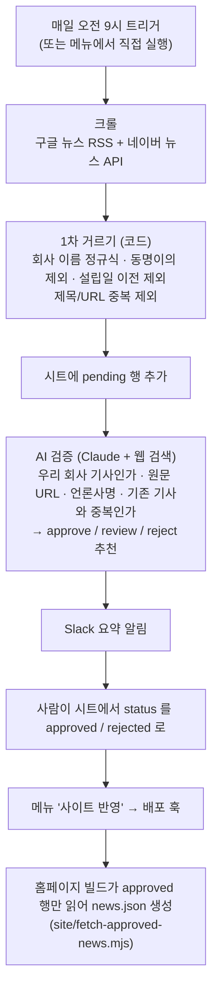

# news-clipping-apps-script

회사 이름이 나온 기사를 매일 찾아 구글 시트에 모으고, AI가 먼저 "정말 우리 회사 기사인지, 원문은 어디인지, 이미 올린 기사와 겹치는지"를 확인해 두는 도구입니다. 사람은 시트에서 게시할 기사만 고르고 메뉴 한 번으로 홈페이지에 반영합니다.

실제 회사 홈페이지의 '언론 보도' 섹션을 이 방식으로 운영하고 있고, 이 저장소는 회사 이름과 검색어를 예시값으로 바꾼 공개본입니다.

- **서버 없음**: 크롤링, AI 검증, 알림, 매일 자동 실행이 전부 구글 시트에 붙은 Apps Script 안에서 돕니다.
- **시트가 곧 관리 화면**: 개발자가 아니어도 시트에서 승인할 수 있습니다.
- **최종 결정은 사람이**: AI는 추천(`ai_verdict`)과 이유(`ai_reason`)만 쓰고, 게시 여부(`status`)는 사람이 정합니다.

## 흐름



## 시트 구조

첫 번째 탭의 1행에 아래 열 이름이 있어야 합니다. 열 순서는 상관없습니다(코드가 열 이름으로 위치를 찾습니다). 다른 열을 더 둬도 됩니다.

| 열 | 누가 쓰나 | 내용 |
| --- | --- | --- |
| `status` | 크롤이 `pending`, 이후는 사람 | `pending` / `approved` / `rejected`. 코드는 `pending` 말고는 쓰지 않음 |
| `title`, `date` | 크롤 | 기사 제목, `YYYY.MM.DD` (한국 날짜) |
| `media`, `url` | 크롤, AI가 고침 | 언론사명, 기사 주소. AI가 원문 주소와 정확한 언론사명을 찾으면 덮어씀 |
| `image`, `description` | 사람 (선택) | 홈페이지 카드에 쓸 이미지 주소, 한두 문장 요약 |
| `ai_verdict`, `ai_reason` | AI | 추천(`approve`·`review`·`reject`)과 이유. 비어 있는 행만 검증함 |

## 세팅

### 0. 준비물

- 구글 계정
- Anthropic API 키 ([console.anthropic.com](https://console.anthropic.com) → API Keys, 크레딧 필요)
- 선택: 네이버 검색 API 키, Slack Incoming Webhook, 홈페이지 배포 훅(Vercel 등)
- 홈페이지에 연결할 때: Google Cloud 프로젝트와 서비스 계정 ([7단계](#7-홈페이지에서-승인된-기사-읽기))

### 1. 시트 만들기

1. 새 구글 시트를 만들고 **파일 → 가져오기 → 업로드**로 [`sheet-template.csv`](sheet-template.csv)를 올린 뒤 "현재 시트 바꾸기"를 고릅니다. (또는 1행에 열 이름을 직접 입력)
2. A열(`status`)을 선택하고 **삽입 → 드롭다운**에서 `pending`, `approved`, `rejected` 세 값을 만듭니다. 승인할 때 고르기 편해집니다.
3. 첫 번째 탭을 씁니다. 다른 탭은 스크립트가 보지 않습니다.

### 2. Apps Script 붙이기

1. 시트에서 **확장 프로그램 → Apps Script**를 엽니다.
2. 편집기의 `Code.gs` 내용을 모두 지우고 [`apps-script/Code.gs`](apps-script/Code.gs)를 통째로 붙여 넣은 뒤 저장합니다.
3. 왼쪽 **프로젝트 설정(톱니바퀴)**에서 시간대를 `(GMT+09:00) 서울`로 바꿉니다. 매일 실행 시각과 날짜 계산이 이 시간대를 따릅니다.

[clasp](https://github.com/google/clasp)를 쓴다면 `apps-script/` 폴더(`appsscript.json` 포함)를 그대로 push하면 됩니다.

### 3. 설정 블록 고치기

`Code.gs` 위쪽의 **설정** 블록만 우리 회사에 맞게 바꿉니다.

| 값 | 하는 일 | 예시 |
| --- | --- | --- |
| `COMPANY_ABOUT` | AI에게 보여 줄 회사 소개 한 줄. 판단 기준이 된다 | `"샘플테크(SampleTech)는 물류 로봇을 만드는 스타트업이다 (제품: 샘플원)."` |
| `COMPANY_NAMES` | 프롬프트에서 '이 회사'로 부를 이름들 | `"샘플테크/SampleTech/샘플원"` |
| `NOT_US` | 이름이 같거나 비슷하지만 우리가 아닌 곳 (AI용) | `['"샘플테크자산운용"(자산운용사)']` |
| `KEYWORDS` | 검색어. 키워드마다 구글·네이버를 한 번씩 검색 | `["샘플테크", "SampleTech", "샘플원"]` |
| `RELEVANCE` | 제목이나 본문 조각에 이 중 하나가 있어야 후보로 받음 | `[/샘플\s?테크/, /sample\s?tech/i]` |
| `DENY` | 하나라도 있으면 버림 (이름만 같은 회사) | `[/샘플테크\s?자산운용/]` |
| `OLDEST_DATE` | 이 날짜 이전 기사는 받지 않음 (설립일 등) | `"2023.01.01"` |

1차 거르기(`RELEVANCE`, `DENY`)는 넉넉하게 두고, 애매한 것은 AI 검증과 사람이 거르게 하는 편이 기사를 덜 놓칩니다. 다른 단어의 일부로 걸리는 이름은 정규식의 뒤돌아보기로 막을 수 있습니다(예: `/(?<!카사)노바/`는 '카사노바'를 거릅니다).

### 4. 비밀값 넣기 (Script Properties)

**프로젝트 설정 → 스크립트 속성 → 속성 추가**에 넣습니다. 코드에는 키를 쓰지 않습니다.

| 이름 | 필요한 때 | 발급 방법 |
| --- | --- | --- |
| `ANTHROPIC_API_KEY` | AI 검증 | console.anthropic.com → API Keys → Create Key |
| `NAVER_CLIENT_ID`, `NAVER_CLIENT_SECRET` | 선택. 없으면 구글 뉴스만 검색 | [developers.naver.com](https://developers.naver.com) → Application → 애플리케이션 등록 → 사용 API에 **검색** 추가 → Client ID / Client Secret |
| `SLACK_WEBHOOK_URL` | 선택. 없으면 알림 생략 | Slack 앱 만들기 → Incoming Webhooks 켜기 → 채널 선택 → Webhook URL |
| `DEPLOY_HOOK_URL` | 메뉴 '사이트 반영' | Vercel: Project Settings → Git → Deploy Hooks에서 이름·브랜치를 정해 만든 URL (Netlify는 Build hooks) |

네이버 뉴스 API는 원문 주소(`originallink`)와 본문 조각을 함께 줘서, 제목에 회사 이름이 없는 인터뷰·기획 기사까지 잡을 수 있습니다. 가능하면 넣는 것을 권합니다.

### 5. 첫 실행과 권한 승인

1. 시트를 새로고침하면 메뉴에 **뉴스 관리**가 생깁니다.
2. **지금 크롤 실행**을 누르면 권한을 묻습니다. 계정을 고른 뒤 "Google에서 확인하지 않은 앱" 경고가 나오면 **고급 → (프로젝트 이름)(으)로 이동 → 허용**을 누릅니다. 내가 만든 스크립트라서 나오는 경고입니다.
3. 새 후보가 `pending` 행으로 추가되는지 확인하고, **AI 검증**을 눌러 `ai_verdict`·`ai_reason`이 채워지는지 봅니다.
4. **매일 자동 실행 설정**을 한 번 누르면 매일 오전 9~10시에 크롤 → AI 검증 → Slack 요약이 돕니다. 설치된 트리거는 Apps Script 편집기 왼쪽의 시계 아이콘에서 볼 수 있습니다.

### 6. 매일 하는 일: 검토와 게시

1. Slack 요약을 받으면 시트를 열어 `ai_verdict`와 `ai_reason`을 보고 `status`를 `approved` 또는 `rejected`로 바꿉니다.
   - `approve`: 우리 회사가 기사의 주제 (인터뷰, 투자·수상·제품 소식)
   - `review`: 등장은 하지만 주제는 따로 있음 (선정 기업 목록, 참가사 나열 등) — 게시할지 사람이 판단
   - `reject`: 우리 회사가 아니거나 이미 게시한 기사와 같은 기사
2. 필요하면 `image`(대표 이미지 주소)와 `description`(한두 문장)을 채웁니다.
3. 다 골랐으면 **사이트 반영**을 누릅니다. 배포 훅이 홈페이지를 다시 빌드하고, 1~2분 뒤 반영됩니다.

어떤 행을 다시 검증하고 싶으면 그 행의 `ai_verdict` 칸을 비우고 **AI 검증**을 누릅니다.

### 7. 홈페이지에서 승인된 기사 읽기

시트를 '웹에 게시'해서 읽으면 검토 중인 후보와 AI 판단 이유까지 누구나 볼 수 있습니다. 그래서 시트를 **읽기 전용 서비스 계정**에만 공유하고, 홈페이지를 빌드할 때 그 계정으로 읽습니다.

1. [Google Cloud 콘솔](https://console.cloud.google.com)에서 프로젝트를 만들고 **API 및 서비스 → 라이브러리**에서 **Google Sheets API**를 사용 설정합니다.
2. **IAM 및 관리자 → 서비스 계정 → 서비스 계정 만들기**(역할은 주지 않아도 됩니다) → 만든 계정의 **키 → 키 추가 → 새 키 만들기 → JSON**으로 키 파일을 받습니다.
3. 시트의 **공유**에서 서비스 계정 이메일(`...@...iam.gserviceaccount.com`)을 **뷰어**로 추가합니다.
4. 홈페이지 배포 환경(Vercel 프로젝트 설정 등)에 환경 변수를 넣습니다.
   - `NEWS_SHEET_ID`: 시트 주소의 `/d/`와 `/edit` 사이 값
   - `GOOGLE_SERVICE_ACCOUNT_JSON`: 받은 JSON 파일 내용 전체
5. [`site/fetch-approved-news.mjs`](site/fetch-approved-news.mjs)를 홈페이지 프로젝트에 복사하고 `npm install google-auth-library` 후, 빌드 전에 돌게 합니다.

```json
{
  "scripts": {
    "prebuild": "node scripts/fetch-approved-news.mjs"
  }
}
```

`NEWS_OUTPUT`(기본 `news.json`)에 이런 파일이 생기고, 화면은 이 파일을 읽어 그리면 됩니다. `image`가 빈 행에 쓸 기본 이미지는 `NEWS_FALLBACK_IMAGE`로 정할 수 있습니다.

```json
[
  {
    "title": "샘플테크, 시리즈A 100억 원 유치",
    "media": "한국경제",
    "date": "2025.03.02",
    "url": "https://www.hankyung.com/article/...",
    "image": "https://.../og.jpg",
    "description": "물류 로봇 스타트업 샘플테크가 ..."
  }
]
```

자격 증명이 없거나 시트를 읽지 못하면 빌드를 멈추지 않고 빈 목록을 씁니다(로컬 개발에서도 빌드가 돌도록). 화면에서는 빈 목록일 때 코드에 넣어 둔 기본 목록을 보여 주게 만들어 두면 안전합니다.

> 회사(Google Workspace) 계정에서는 조직 정책으로 서비스 계정 키 만들기가 막혀 있을 수 있습니다. 그때는 관리자에게 해당 프로젝트만 예외를 요청해야 합니다.

## 비용

AI 검증 비용은 기사 1건마다 이렇게 쌓입니다(2026년 10월 공식 가격표 기준).

| 항목 | 가격 | 이 스크립트에서 |
| --- | --- | --- |
| 웹 검색 | 1,000회당 $10 | 기사당 최대 3회(`max_uses: 3`) → 최대 $0.03 |
| 웹 페치 | 추가 요금 없음 | 가져온 페이지는 입력 토큰으로 계산(10kB 페이지 ≈ 2,500토큰) |
| 토큰 (`claude-opus-4-8`) | 100만 토큰당 입력 $5 / 출력 $25 | 프롬프트 + 기존 게시 기사 목록(최대 60개) + 검색 결과 + 가져온 페이지 |

검색 결과와 가져온 페이지가 모두 입력 토큰으로 들어가서, 실제 금액은 기사마다 검색을 몇 번 했고 페이지를 얼마나 읽었는지에 따라 달라집니다. 처음 며칠은 Anthropic Console의 사용량 화면에서 하루 비용을 확인하는 것을 권합니다. 줄이고 싶다면 `max_uses`를 낮추거나, 프롬프트에 넣는 기존 기사 수(`published.slice(0, 60)`)를 줄이면 됩니다.

### 모델 바꾸기

기본값 `claude-opus-4-8`은 `thinking`을 보내지 않으면 생각 단계 없이 답하므로 출력 한도 2,048토큰(`VERIFY_MAX_TOKENS`)으로 충분합니다. Claude Opus 5.5·Sonnet 5.5 같은 최신 모델은 생각 단계가 항상(또는 기본으로) 켜져 있고, 그 토큰도 출력 한도에 포함됩니다. 이런 모델로 바꾸면 `VERIFY_MAX_TOKENS`를 크게(예: 16,000) 올리고, 몇 건을 직접 돌려 응답이 잘리지 않는지 확인하세요. 잘리면 스크립트가 "max_tokens에서 잘렸습니다"라고 알려 줍니다.

웹 검색·웹 페치 도구 버전(`web_search_20260209`, `web_fetch_20260209`)은 Opus 4.6 / Sonnet 4.6 이후 모델용입니다. 그보다 오래된 모델은 `web_search_20250305`, `web_fetch_20250910`을 써야 합니다.

## 설계 메모

**왜 Apps Script인가.** 처음에는 GitHub Actions에서 Node 스크립트로 크롤하고(서비스 계정 키로 시트에 쓰기), 검증은 따로 예약한 AI 에이전트가 하는 구조로 만들었습니다. 이것을 시트 하나에 붙은 스크립트로 합치자 크롤용 서버·스케줄러·키 파일이 모두 필요 없어졌고, 시트를 쓰는 사람이 메뉴에서 직접 다시 돌려 볼 수도 있게 됐습니다. 서비스 계정은 홈페이지 빌드가 승인된 행을 읽을 때만 씁니다.

**AI는 추천만 합니다.** 잘못 게시되면 회사 홈페이지에 다른 회사 기사가 걸립니다. 그래서 AI는 `ai_verdict`·`ai_reason`에만 쓰고 `status`는 코드가 절대 쓰지 않습니다. "등장은 하지만 주제가 아닌 기사"는 `reject`가 아니라 `review`로 두게 해서, 게시 여부를 사람이 고르게 했습니다.

**1차는 넓게, 2차는 좁게.** 인터뷰·기획 기사는 제목에 회사 이름이 없는 경우가 많아, 제목에 없으면 네이버가 주는 본문 조각까지 봅니다. 그만큼 이름만 같은 회사가 많이 걸리므로 `DENY`와 설립일 하한으로 한 번 거르고, AI가 기사를 직접 찾아 읽고 다시 거릅니다.

**중복은 제목 또는 주소로.** 같은 기사가 언론사 이름이나 추적 파라미터만 달리해서 다시 들어옵니다(`utm_source`가 붙은 주소로 같은 기사가 두 번 들어온 적이 있습니다). 그래서 정규화한 제목이나 추적 파라미터를 지운 주소 중 하나만 같아도 중복으로 봅니다. 언론사명은 AI가 나중에 고치기 때문에 중복 판단 기준에서 뺐습니다(넣으면 고친 다음 날 같은 기사가 새 기사처럼 보입니다).

**구글 뉴스 링크는 원문이 아닙니다.** 구글 뉴스 RSS의 링크는 `news.google.com` 리다이렉트라서, AI가 "제목 + 언론사"로 웹 검색해 원문 주소를 찾아 덮어씁니다. 네이버는 원문 주소를 바로 줍니다.

**날짜는 한국 기준으로.** 발행 시각을 UTC 날짜로 저장하면 오전 9시 전에 나온 기사가 하루 앞 날짜가 되고, 설립일 하한에 걸려 버려지는 경우가 생깁니다.

**실패해도 행을 망가뜨리지 않습니다.**

| 상황 | 처리 |
| --- | --- |
| API 호출 실패 | 그 행의 `ai_verdict`를 비워 둔다. 채우면 '검증 끝'으로 보고 영영 건너뛰기 때문 |
| 400·401 같은 요청 오류 | 남은 행도 똑같이 실패하므로 바로 멈추고 원인을 알림 (크레딧 부족, 모델 이름 오타 등) |
| 429·5xx | 그 행만 다음 실행으로 미루고 나머지는 계속 |
| 응답이 `max_tokens`에서 잘림 | 설정 문제이므로 올려야 할 값을 그대로 알림 |
| 웹 검색 중 `pause_turn` | 받은 턴을 그대로 붙여 이어 보냄(최대 4번). 이어 달라는 말은 덧붙이지 않는다 |
| 모델이 판단을 거절(`refusal`) | `review`로 남겨 사람이 보게 함 (그냥 두면 매 실행마다 같은 행을 다시 부른다) |
| 응답에서 JSON을 못 읽음 | 그 행만 건너뛰고 다음 실행 때 재시도 |

**실행 시간 6분 제한.** Apps Script 한 번 실행은 약 6분까지라서 한 번에 6건까지만 검증하고, 남은 건은 다음 실행 때 이어서 합니다.

## 테스트

```bash
npm install
npm test
```

`Code.gs`는 Apps Script 전용이라 import할 수 없어서, Node의 `vm`에서 파일을 그대로 실행하고 Apps Script 전역 객체(`UrlFetchApp`, `PropertiesService`)와 시트를 가짜로 넣어 검증합니다([`test/load-script.mjs`](test/load-script.mjs)).

| 대상 | 내용 |
| --- | --- |
| 후보 정리 | 추적 파라미터 제거, 제목 정규화, 한국 날짜 변환, 본문 조각 판정과 동명이의 제외, 설립일 하한 |
| `crawlCore_` | 제목·주소 중복, 같은 실행 안의 중복, 설립 이전·무관한 기사 제외, 날짜순 정렬, 열 순서가 바뀐 시트 |
| `verifyOne_` | `pause_turn` 이어 보내기, `max_tokens` 잘림, 429·5xx와 400 구분, `refusal`, 느슨한 JSON 읽기 |
| `verifyCore_` | 실패한 행 비워 두기, '우리 회사 아님'·중복은 `reject`, `status` 칸 안 건드림, 400이면 즉시 중단, 한 번에 6건 |
| 홈페이지 읽기 | 열 이름으로 객체 만들기, `approved`만 최신순, 자격 증명이 없을 때 빈 목록 |

실제 구글 서비스(메뉴, 트리거, 시트 API)와 Anthropic API에 붙는 부분은 테스트하지 않습니다. 홈페이지 읽기 스크립트는 가짜 키로 구글 인증 서버까지 요청이 가는 것만 확인했습니다.

## 한계

- `image`와 `description`은 사람이 채웁니다. AI가 대표 이미지를 가져오거나 요약을 쓰지는 않습니다.
- 매일 자동 실행은 하루 6건까지 검증합니다. 후보가 많은 날은 메뉴에서 **AI 검증**을 더 누르거나 다음 날 이어서 검증됩니다.
- 구글 뉴스 RSS는 공식 API가 아니라서 형식이 바뀌면 크롤이 조용히 0건이 될 수 있습니다.
- 영문 홈페이지용 번역은 들어 있지 않습니다.

## 구조

```
apps-script/
  Code.gs                  시트에 붙이는 스크립트 전체 (크롤, AI 검증, 알림, 트리거, 사이트 반영)
  appsscript.json          clasp용 매니페스트 (시간대 Asia/Seoul)
site/
  fetch-approved-news.mjs  홈페이지 빌드 전에 approved 행만 읽어 news.json 생성
sheet-template.csv         1행 열 이름 (시트 가져오기용)
test/                      Node 테스트 (Code.gs를 vm에서 실행)
```

## 라이선스

MIT
